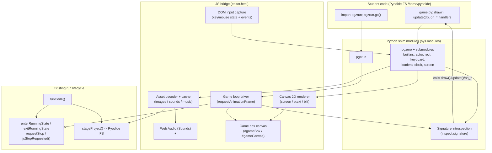
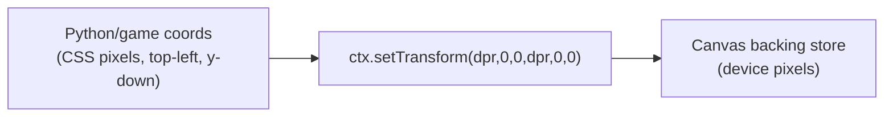
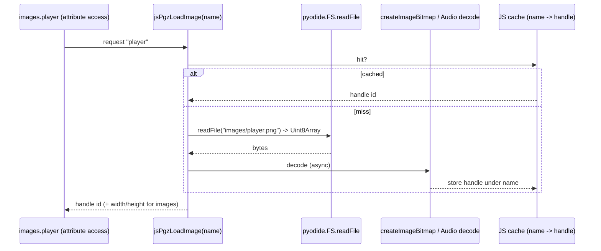
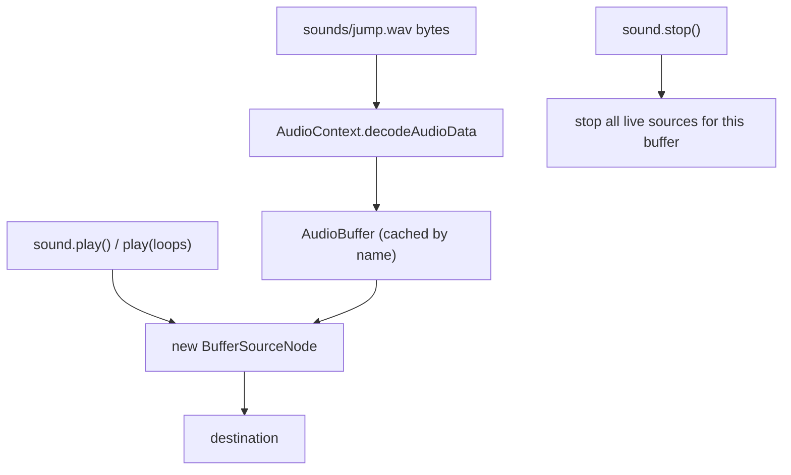
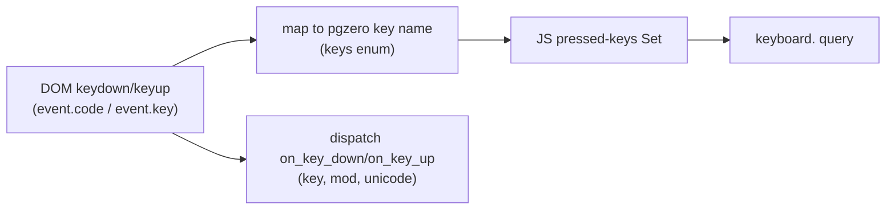
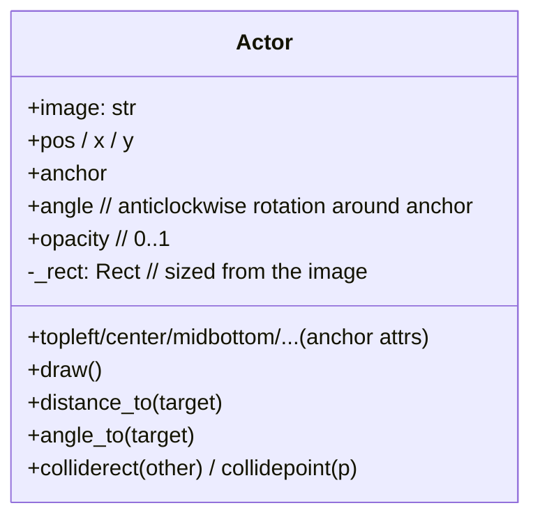

# Design Document: Pygame Zero Support (pgzero shim)

## Overview

This feature adds **Pygame Zero (pgzero)** support to the `learn-python` browser editor as a
**shim** — a set of small Python modules registered in `sys.modules`, backed by a JavaScript
bridge that renders to an in-page canvas. No real `pygame` or `pygbag` is used. The goal is
fidelity to the official Pygame Zero API so that the *same student code runs unchanged in
Thonny* after `pip install pgzero`.

The shim follows the pattern already established by the `turtle` and `guizero` shims in
`editor.html`: a Python module built with `pyodide.runPython(...)`, a JS bridge that draws to a
dedicated canvas "box" in the output pane, a `_reset()` called per run, and usage-detection in
`runCode()`. Unlike turtle (centred origin, y-up), pgzero uses a **top-left origin, y-down,
pixel** coordinate system that maps directly onto the HTML canvas, simplifying rendering.

Two explicit scope decisions shape the architecture:

1. **Explicit launch** — students must write `import pgzrun` and call `pgzrun.go()`. The shim
   does **not** auto-detect `draw`/`update`; the game loop starts only when `pgzrun.go()` is
   called. This removes the need for module-scope introspection of the student script and makes
   the loop lifecycle explicit.
2. **No OS window / ignore `WIDTH`/`HEIGHT`** — there is no separate window. The game renders
   into a canvas sized to the editor's game box. `screen` dimensions are *derived from the
   canvas size*, and the module-level `WIDTH`/`HEIGHT` constants (if a student sets them) are
   ignored for sizing.

The design is organized to support **incremental delivery in 5 phases** (drawing → events →
actors/images → sounds → music), plus a final documentation deliverable (cheatsheet + hub card
+ samples).

### Out of scope (v1)

- `animate()` and all tweening.
- The Tone Generator (`tone`).
- Custom fonts / a `fonts/` asset area (ptext uses the system/default font only; `fontname` is
  accepted and ignored). Noted as a future extension.
- `storage` (persistent JSON dict). Noted as a future extension.

---

## Architecture

### High-level component map



### Where the pieces live

| Layer | Location | Responsibility |
|-------|----------|----------------|
| Python shim | `editor.html`, new `pyodide.runPython(...)` block | `pgzrun`, `pgzero` package + submodules, `Rect`/`ZRect`, `Actor`, loaders, `clock`, `keyboard`, enums |
| JS bridge | `editor.html` `<script>` | game-loop driver, canvas renderer, input capture, asset decode/cache, audio |
| HTML/CSS | `editor.html` result-pane markup + styles | `#gameBox` wrapper + `#gameCanvas` |
| Lifecycle hooks | `runCode()`, `clearOutput()` | usage-detection, `_reset()`, box reveal, teardown on Stop/next run |

The pgzero Python modules are registered **after** the JS bridge functions are defined, mirroring
turtle/guizero, so the module's `from js import jsPgz*` succeeds.

### Design principle: thin Python, rendering in JS

The Python side holds **game state and API shape** (the classes/objects students touch) and
converts values into primitive, JS-friendly forms (numbers, strings, tuples→lists). The JS side
owns the **canvas, DOM input, asset decoding, and audio**. All drawing is expressed as calls
across the bridge that paint pixels. This matches the established turtle pattern ("We only paint
pixels") and keeps per-frame interop cheap.

---

## The Game Loop

This is the central design problem. The existing runner is a **statement-stepped async**
executor: the AST transform inserts `await __tick()` between statements, and `jsTick()` yields a
frame when output was produced. A pgzero game is instead a **continuous render loop** driven by
`requestAnimationFrame` (rAF). The two must coexist within one Run/Stop lifecycle.

### Lifecycle integration

```mermaid
sequenceDiagram
    participant U as User
    participant RC as runCode()
    participant PY as Student code
    participant PR as pgzrun.go()
    participant JS as JS loop driver (rAF)
    participant REND as Renderer/Hooks

    U->>RC: click Run
    RC->>RC: enterRunningState() (stopRequested=false)
    RC->>RC: stageProject(); pgzero._reset()
    RC->>PY: await __run_user_code(source)
    PY->>PY: define draw/update/on_*  (module scope)
    PY->>PR: pgzrun.go()
    PR->>JS: jsPgzStartLoop(hooks proxy)
    PR-->>PY: returns (awaits a Future that resolves on stop)
    loop every animation frame until stop
        JS->>JS: dt = (now - last)/1000
        JS->>REND: update(dt)  [introspected]
        JS->>REND: draw()      [introspected]
        JS->>JS: if jsStopRequested() -> break
    end
    U->>RC: click Stop (or next Run)
    RC->>JS: requestStop() -> stopRequested=true
    JS->>JS: cancelAnimationFrame; resolve go()'s Future
    PR-->>PY: pgzrun.go() returns
    PY-->>RC: __run_user_code resolves
    RC->>RC: exitRunningState(); teardown audio
```

### How `pgzrun.go()` works

`pgzrun.go()` is an **async-aware blocking call**: it starts the JS loop, then awaits a Python
`asyncio.Future` that only resolves when the loop ends (Stop pressed, next Run, or an unrecovered
per-frame exception). Because the existing runner already runs user code inside an async function
(`__main`/`__run_user_code`), awaiting a Future here integrates cleanly — control returns to the
browser between frames, keeping the page responsive.

```python
# pgzrun module (sketch)
import asyncio
from js import jsPgzStartLoop, jsPgzStopLoop

async def go():
    loop_done = asyncio.get_event_loop().create_future()
    # Hand the renderer/hook-dispatcher and a resolver to JS.
    _state.loop_done = loop_done
    jsPgzStartLoop()          # JS begins requestAnimationFrame
    try:
        await loop_done        # returns when JS stops the loop
    finally:
        jsPgzStopLoop()        # idempotent cleanup (cancel rAF)
```

> **Why `go()` and not auto-detection?** With explicit `go()`, the shim does not need to scan the
> student module for `draw`/`update` definitions or hijack program end-of-script. The game loop
> has one obvious entry and exit point.

### The frame callback (JS)

```js
// JS bridge (sketch)
let pgzRafId = 0, pgzLastTs = 0, pgzLooping = false;

function pgzFrame(ts) {
  if (!pgzLooping) return;
  if (globalThis.jsStopRequested()) { pgzEndLoop(); return; }
  const dt = pgzLastTs ? (ts - pgzLastTs) / 1000 : 0;   // seconds
  pgzLastTs = ts;
  try {
    pgzClock.tick(dt);        // fire due clock.schedule_* callbacks
    pgzCallUpdate(dt);        // introspected: update() or update(dt)
    pgzCallDraw();            // draw(); paints into #gameCanvas
  } catch (e) {
    pgzReportFrameError(e);   // surface ONCE to output pane, then stop
    pgzEndLoop();
    return;
  }
  pgzRafId = requestAnimationFrame(pgzFrame);
}
```

### dt computation

`dt` is the elapsed wall-clock time between consecutive rAF callbacks, in **seconds**
(`(ts - lastTs) / 1000`), matching pgzero's `update(dt)` contract. The first frame uses `dt = 0`.
Optionally clamp `dt` to a sane maximum (e.g. 0.1s) so a backgrounded tab that pauses rAF does not
produce a huge jump on resume.

### Coexistence with the `__tick` runner

- The student's top-level code (defining handlers, loading assets, calling `pgzrun.go()`) still
  runs through the statement-stepped async runner. `__tick()` yields are harmless.
- Once `go()` is awaiting its Future, the statement runner is effectively idle (parked on the
  await); the **rAF loop is the active driver**. Hook calls (`update`/`draw`/`on_*`) are plain
  (synchronous) Python calls from JS via PyProxies — they are *not* routed through `__tick`, so
  they run at full frame rate without yield overhead.
- Per-frame cooperative-stop is achieved by the JS loop polling `jsStopRequested()` at the top of
  every frame (shown above), in addition to the existing input()/`__tick` stop paths.

### Teardown on Stop / next run

`pgzEndLoop()` must be **idempotent** and called from every exit path:

- **Stop button** → `requestStop()` sets `stopRequested`; next `pgzFrame` observes it and calls
  `pgzEndLoop()`.
- **Next Run** → `runCode()` → `clearOutput()`/`pgzero._reset()` calls `jsPgzStopLoop()` to cancel
  any lingering loop from a previous run before starting fresh.
- **Per-frame exception** → caught in `pgzFrame`, reported once, loop ended.

`pgzEndLoop()` does: `cancelAnimationFrame(pgzRafId)`, `pgzLooping=false`, stop all audio
(Sounds + music), resolve the Python `loop_done` Future (so `go()` returns and
`__run_user_code` can finish), and leave the final frame painted on the canvas.

### Per-frame exception handling

A Python exception inside `update`/`draw`/`on_*` is caught in the JS frame callback. It is
formatted (via a Python helper that renders a short traceback) and written **once** to the output
pane through the normal `appendOutput(..., "error")` path, then the loop is stopped. This prevents
error spam (one error per frame at 60fps). A dedicated `jsPgzReportError(msg)` bridge reuses the
existing error-output styling.

---

## Handler Signature Introspection

Pygame Zero inspects each hook's **parameter names** to decide what to pass. The shim must
replicate this: for every call it inspects the handler signature with `inspect.signature` and
passes only the parameters the handler names, by name.

This logic lives in Python (it needs `inspect`), exposed to JS as a single dispatch entry point
per hook, or a generic `jsPgzDispatch(name, kwargsProxy)` that the Python side resolves.

```python
import inspect

# All available arguments the engine can provide for a given hook, by name.
# JS passes raw event data; Python builds the full candidate dict then filters.
def _call_with_known_args(func, available: dict):
    if func is None:
        return
    try:
        params = inspect.signature(func).parameters
    except (TypeError, ValueError):
        return func()                     # builtins etc.: call with no args
    kwargs = {name: available[name] for name in params if name in available}
    return func(**kwargs)
```

Hook argument vocabularies (the keys the engine may provide):

| Hook | Available argument names |
|------|--------------------------|
| `draw` | (none) |
| `update` | `dt` |
| `on_mouse_down` | `pos`, `button` |
| `on_mouse_up` | `pos`, `button` |
| `on_mouse_move` | `pos`, `rel`, `buttons` |
| `on_key_down` | `key`, `mod`, `unicode` |
| `on_key_up` | `key`, `mod` |
| `on_music_end` | (none) |

Example fidelity: `def on_mouse_down(pos):` receives only `pos`; `def on_mouse_down(pos, button):`
receives both; `def on_mouse_down():` receives nothing — exactly as real pgzero.

The dispatcher resolves hook functions by looking them up in the **student module's namespace**
each frame (so late (re)definitions and `None`-absence are handled), passed to the shim at
`go()` time as the module globals dict.

---

## Canvas, Coordinate System, and Sizing

### No WIDTH/HEIGHT: canvas fills the game box

Because there is no OS window, the canvas **fills the game box** laid out in the result pane. The
`screen` surface dimensions are **derived from the canvas's displayed (CSS-pixel) size** — the
same technique turtle uses (`jsTurtleSize()` reports CSS size to Python). A new
`jsPgzScreenSize()` returns `[cssW, cssH]`.

Any `WIDTH`/`HEIGHT` a student assigns at module scope is simply ignored for layout. The design
note for the cheatsheet: *"In this editor the game fills the game area; WIDTH and HEIGHT are
ignored. Use `WIDTH, HEIGHT = screen.width, screen.height` or `screen.bounds()` if you need the
size."* (We can still expose `WIDTH`/`HEIGHT` names on the module set to the live canvas size so
code that reads them keeps working.)

### Coordinate system

pgzero uses **top-left origin, x-right, y-down, pixels** — identical to the HTML canvas default.
No flip or translate is needed (contrast turtle, which centres and flips). This keeps `screen`,
`Actor.pos`, `Rect`, mouse positions, and ptext positioning direct.

### DPR crispness

Reuse turtle's device-pixel-ratio approach: back the canvas store with `cssW*dpr × cssH*dpr`
device pixels, and `ctx.setTransform(dpr,0,0,dpr,0,0)` so all drawing is expressed in CSS pixels.
A `pgzResize()` (mirroring `turtleResize()`) runs on first reveal and on container resize.



### Game box layout

A new box is added to the result pane alongside the turtle canvas, gui box, and chart box:

```html
<!-- Game box: a Pygame Zero game renders here. Hidden until first draw/go(). -->
<div class="game-box" id="gameBox"><canvas id="gameCanvas"></canvas></div>
```

It is shown on the first frame (or at `go()`), hidden and cleared on reset — mirroring
`chartBox`/`guiBox`/`turtleWrap`. The existing "(no output)" suppression check in `runCode()` is
extended to also treat a visible game box as output.

---

## Asset Pipeline

### Source of truth: the Pyodide FS

`stageProject()` already writes uploaded assets to `WORKDIR/{images,sounds,music,data}`
(`WORKDIR=/home/pyodide`). pgzero asset resolution maps directly:

| pgzero loader | FS path | Decoded to (JS) |
|---------------|---------|-----------------|
| `images.<name>` | `images/<name>.png` (also `.jpg`/`.gif`) | `ImageBitmap` / `HTMLImageElement` |
| `sounds.<name>` | `sounds/<name>.wav` (also `.ogg`) | Web Audio `AudioBuffer` |
| `music.play("<name>")` | `music/<name>.mp3` (also `.ogg`) | `<audio>` element (streamed) |

### Flow



### Name restrictions

pgzero requires asset names to be **lowercase letters, numbers, and underscores, starting with a
letter**. The Python loaders validate names and raise a clear error (matching pgzero's behaviour)
before hitting the FS. File extension resolution tries the known extensions per media type.

### Caching and lazy loading semantics

- `images` and `sounds` are attribute/`__getitem__` accessors that **lazily load and cache** by
  name. First access decodes; subsequent accesses return the cached handle.
- Images must be decoded **before** the first `draw()` uses them. Two options, decide at
  implementation time:
  1. **Preload at access time** — when the student does `images.player` during setup, kick off
     decode and (because decode is async) `await` readiness before `go()`'s loop starts. Simplest
     correct approach given assets are referenced during setup.
  2. **Synchronous-looking via pre-decode** — eagerly decode all files in `images/` at `_reset()`
     time, so attribute access returns a ready handle. Acceptable given small project sizes.
- The design recommends **eager decode of the staged `images/` and `sounds/` directories during
  `_reset()`** (bounded, small) so that per-frame `blit`/`Actor.draw()` and `sounds.x.play()` are
  fully synchronous. Music is streamed and loaded on first `music.play()`.

Handles are referenced from Python by an **opaque id/name**; Python never holds the pixel data.
`screen.blit(image, pos)` passes the id to `jsPgzBlit(id, x, y, ...)`.

---

## Audio

Two distinct mechanisms, matching pgzero's split between short effects and streamed music.

### Sounds — Web Audio (`sounds` loader + `Sound`)



- `Sound.play()` creates a one-shot `AudioBufferSourceNode` → concurrent playback is natural.
- `Sound.play(loops)` sets `source.loop = true` and tracks remaining loop count (or schedules
  restarts) to honour a finite loop count.
- `Sound.stop()` stops all live sources started from this buffer.
- `Sound.get_length()` returns `AudioBuffer.duration` (seconds).
- JS tracks the set of **live source nodes** so `pgzEndLoop()`/`_reset()` can stop everything.

### Music — a single `<audio>` channel (`music`)

Only **one** music track plays at a time. Backed by a single reusable `<audio>` element.

| pgzero `music` API | Implementation |
|--------------------|----------------|
| `play(name)` | set `audio.loop=true`, `src` from `music/<name>.mp3`, `play()` (loops forever) |
| `play_once(name)` | `audio.loop=false`, play once |
| `queue(name)` | push to a JS queue; on `ended`, advance to next queued track |
| `stop()` | pause + reset `currentTime`, clear queue |
| `pause()` / `unpause()` | `audio.pause()` / `audio.play()` |
| `is_playing(name)` | `!audio.paused` and current src matches name |
| `fadeout(duration)` | ramp `audio.volume` → 0 over `duration` seconds (timer/interval), then stop |
| `set_volume(v)` / `get_volume()` | `audio.volume` (0–1) |

**`on_music_end` hook**: the `<audio>` `ended` event (for non-looping / `play_once` / end of
queue) dispatches through the hook introspection path (`on_music_end` takes no args). When a
queued track exists, `ended` advances the queue instead of firing the hook.

### Stopping audio on Stop/reset

`pgzEndLoop()` and `_reset()` both call a `jsPgzStopAllAudio()` that stops every live Web Audio
source and pauses/resets the music `<audio>`. This guarantees silence when the student presses
Stop or re-runs.

---

## ptext Rendering (screen.draw.text / textbox)

ptext maps a rich option set onto Canvas 2D. All text rendering happens in JS; Python forwards
`text`, position/rect, and a kwargs dict (converted to a plain JS object).

### Option mapping

| ptext option | Canvas 2D realisation |
|--------------|----------------------|
| `color` | `ctx.fillStyle` |
| `background` | fill the text's bounding box first |
| `fontname` | **ignored in v1** (system/default font); accepted for compatibility |
| `fontsize` | `ctx.font` size (px) |
| `antialias` | `ctx.imageSmoothingEnabled` / no-op (canvas text is AA by default) |
| positioning: `top/left/bottom/right/topleft/midtop/center/centerx/centery/...` | compute origin + set `textAlign`/`textBaseline`, or measure and offset |
| `width` / `widthem` / `lineheight` | word-wrap: greedy wrap using `ctx.measureText`; line step = `lineheight * fontsize` |
| `align` | per-line horizontal alignment within the wrap box (`left`/`center`/`right`) |
| `owidth` / `ocolor` | outline: stroke text (`lineWidth`, `strokeStyle`) behind fill, or 8-direction offset draws |
| `shadow` / `scolor` | draw text offset by `shadow=(dx,dy)` in `scolor` behind the fill |
| `gcolor` | vertical gradient fill: `createLinearGradient` from `color` (top) to `gcolor` (bottom) |
| `alpha` | `ctx.globalAlpha` for the text draw |
| `anchor` | fractional `(ax, ay)` anchor within the text box |
| `angle` | rotate: `ctx.translate(anchor)` + `ctx.rotate(-angle)` (anticlockwise) + draw |

### Positioning algorithm (sketch)

```
measure line widths and total block height (accounting for wrap)
resolve the anchor point from whichever positioning kwarg(s) were given
 (exactly one horizontal + one vertical reference, per ptext rules)
translate to the anchor; apply rotation if angle != 0
for each wrapped line:
    if shadow:  draw line offset by shadow in scolor
    if outline: stroke line in ocolor with owidth
    fill line (solid color, or vertical gradient if gcolor)
```

### `textbox` auto-sizing

`screen.draw.textbox(text, rect, **kwargs)` fits the text to the given `Rect` by **binary-/linear-
searching `fontsize`** down until the wrapped text fits within `rect` (width and height), then
renders as `text` within that rect. The search uses the same `measureText`-based wrap used by
`text`.

### Draw subsystem surface (`screen.draw`)

| Method | Canvas 2D |
|--------|-----------|
| `draw.line(start, end, color)` | `moveTo`/`lineTo`/`stroke` |
| `draw.circle(pos, radius, color)` | `arc` + `stroke` |
| `draw.filled_circle(pos, radius, color)` | `arc` + `fill` |
| `draw.rect(rect, color)` | `strokeRect` |
| `draw.filled_rect(rect, color)` | `fillRect` |
| `draw.text(...)` / `draw.textbox(...)` | ptext engine above |

`screen.clear()`, `screen.fill(color, gcolor=None)` (solid or vertical gradient), `screen.bounds()`
(a `Rect` of the whole surface), and `screen.blit(image, (x,y))` complete the surface API.

---

## Keyboard and Mouse

### Keyboard state tracking

A module-level `keyboard` object reflects live key state. JS listens for DOM `keydown`/`keyup`
while a game loop is active and maintains a set of currently-pressed pgzero key names. Python
exposes:

- Attribute access: `keyboard.left`, `keyboard.a`, `keyboard.space` → bool.
- Subscript: `keyboard[keys.A]` → bool.



- `keys` enum: full pgzero key set (`keys.A`…`keys.Z`, digits, arrows, `keys.SPACE`,
  `keys.RETURN`, `keys.LSHIFT`, etc.). A mapping table translates DOM `KeyboardEvent.code`
  (preferred, layout-independent) to pgzero key names.
- `keymods` enum + `mod` bitmask for `on_key_down/up`, built from event modifier flags
  (`shiftKey`, `ctrlKey`, `altKey`, `metaKey`).
- `unicode` for `on_key_down` is the event's printable character (`event.key` when length 1).

### Mouse

- `mouse` enum: `LEFT`, `MIDDLE`, `RIGHT`, `WHEEL_UP`, `WHEEL_DOWN`. DOM `MouseEvent.button`
  (0/1/2) maps to LEFT/MIDDLE/RIGHT; `wheel` events map to WHEEL_UP/WHEEL_DOWN.
- `pos` is the cursor position in **CSS pixels relative to the canvas** (via
  `getBoundingClientRect()`), i.e. game coordinates directly.
- `on_mouse_move` provides `pos`, `rel` (delta since last move), and `buttons` (set of currently
  pressed mouse buttons).
- Listeners are attached to `#gameCanvas` while the loop runs and removed on teardown. The canvas
  must be focusable (`tabindex`) so it can receive key events; it grabs focus on first interaction.

All input events are dispatched through the **same signature-introspection** path as other hooks.

---

## Actors, Rect, and Collision

### Rect / ZRect

`Rect` mirrors pygame's `Rect`: constructed from `(x, y, w, h)`, `((x,y),(w,h))`, or another rect.
It exposes the full attribute set (`x`, `y`, `width`, `height`, `left`, `right`, `top`, `bottom`,
`topleft`, `topright`, `bottomleft`, `bottomright`, `center`, `centerx`, `centery`, `midtop`,
`midbottom`, `midleft`, `midright`, `size`), each readable and writable (writing an anchor moves
the rect). Collision methods: `colliderect`, `collidepoint`, `contains`, `clip`, `union`, etc.
`ZRect` is pgzero's float-friendly variant; provided as an alias/subclass with the same API.

Rects are **pure Python** (no bridge needed for geometry). Only when a rect is used for drawing
(`screen.draw.rect`) are its numbers passed to JS.

### Actor



- Construction: `Actor("alien", pos=(x, y))` loads `images.alien` to learn the natural size, then
  builds its backing `Rect`. Position/anchor attributes delegate to that rect.
- `anchor` defaults to `center`; setting `pos` moves the actor so its anchor is at `pos`.
- `angle` rotates the sprite **anticlockwise around the anchor** when drawn; JS applies
  `translate(anchorPx)` + `rotate(-angle in radians)` + draw image centred on the rotation point.
- `opacity` (0..1) maps to `ctx.globalAlpha` during the actor's blit.
- `draw()` → `jsPgzDrawActor(imageId, x, y, angle, opacity, anchorX, anchorY)`.
- `distance_to(target)` / `angle_to(target)` are pure-Python math against a target point or actor.
- Collision methods delegate to the actor's `Rect`.

---

## clock

- `clock.schedule(callback, delay)` — fire once after `delay` seconds.
- `clock.schedule_unique(callback, delay)` — replace any existing schedule of the same callback.
- `clock.schedule_interval(callback, interval)` — fire repeatedly every `interval` seconds.
- `clock.unschedule(callback)` — cancel.

The clock is advanced from the JS frame callback (`pgzClock.tick(dt)` before `update`). pgzero
uses **weak references** to callbacks; for simplicity the shim keeps **strong references** (noted
as an intentional, documented deviation — acceptable because the whole loop is torn down each
run, so there is no long-lived leak). Due callbacks are invoked via the same introspection helper
(most take no args). This can ship in Phase 1 or 2.

---

## Components and Interfaces

### Python module surface (registered in `sys.modules`)

```
pgzrun                      -> go()
pgzero                      -> package marker
pgzero.builtins            -> screen, Rect, ZRect, Actor, images, sounds, music,
                               clock, keyboard, keys, mouse, keymods,
                               Surface query helpers, Sound (via loader)
pgzero.actor, pgzero.rect, pgzero.loaders, pgzero.clock, pgzero.keyboard,
pgzero.constants           -> submodules for `from pgzero.X import Y` imports
```

Student programs typically rely on pgzero's runner **injecting** builtins into the module global
namespace (students write bare `screen`, `Actor`, `images`, etc. without importing them). The
runner must therefore **inject these names into the student module's globals** before the loop
starts (at `go()` time, or just before executing the student body). This mirrors how real pgzero's
runner populates the module namespace, and is a key fidelity requirement.

### JS ⇄ Python bridge surface

The complete set of bridge functions (all `globalThis.jsPgz*`, defined before the Python module
is registered so `from js import ...` works):

| Bridge function | Direction | Purpose |
|-----------------|-----------|---------|
| `jsPgzScreenSize()` | JS→PY (query) | current canvas size `[w, h]` in CSS px |
| `jsPgzShow()` | PY→JS | reveal + size the game box on first use |
| `jsPgzReset()` | PY→JS | hide/clear canvas, stop audio, cancel loop |
| `jsPgzStartLoop()` | PY→JS | begin requestAnimationFrame loop |
| `jsPgzStopLoop()` | PY→JS | cancel rAF, resolve go()'s Future (idempotent) |
| `jsPgzClear()` / `jsPgzFill(color, gcolor)` | PY→JS | surface clear/fill |
| `jsPgzDrawLine/Circle/FilledCircle/Rect/FilledRect(...)` | PY→JS | primitives |
| `jsPgzDrawText(text, kwargsObj)` / `jsPgzDrawTextbox(text, rect, kwargsObj)` | PY→JS | ptext |
| `jsPgzLoadImage(name)` / `jsPgzLoadSound(name)` | PY→JS | decode + cache, return handle/size |
| `jsPgzBlit(imageId, x, y)` | PY→JS | draw image |
| `jsPgzDrawActor(imageId, x, y, angle, opacity, ...)` | PY→JS | draw rotated/alpha sprite |
| `jsPgzSoundPlay(name, loops)` / `jsPgzSoundStop(name)` / `jsPgzSoundLength(name)` | PY→JS | Web Audio |
| `jsPgzMusicPlay/PlayOnce/Queue/Stop/Pause/Unpause/Fadeout/SetVolume/GetVolume/IsPlaying(...)` | PY→JS | music channel |
| `jsPgzStopAllAudio()` | PY→JS | silence everything |
| `jsPgzDispatch(name, dataObj)` **or** per-hook callbacks | JS→PY | call introspected hook |

The reverse direction (JS invoking Python hooks) is done via a **PyProxy** of a single Python
dispatcher (`_dispatch(hook_name, data)`) handed to JS at `go()` time, which internally applies
the `inspect.signature` filtering. Using one proxy (rather than many) simplifies lifetime
management.

---

## Interop Concerns

- **PyProxy lifetime**: hook functions are looked up through the student-module globals dict
  (held as one PyProxy / passed to the dispatcher), not individually proxied per frame. The single
  dispatcher proxy and the globals proxy are created at `go()` and **destroyed in
  `pgzEndLoop()`/`_reset()`** to avoid leaks. Per-frame calls reuse these — no per-frame proxy
  creation.
- **Tuple/color conversion**: Python passes positions as 2-element lists and colors as CSS strings.
  A Python color helper normalises pgzero color forms (name string, `(r,g,b)`, `(r,g,b,a)`,
  hex string) into a CSS color string before crossing the bridge, reusing existing colour helpers
  where possible.
- **Error surfacing**: a Python `_format_exc()` helper produces a short message; JS writes it once
  via `appendOutput(..., "error")`.
- **Audio cleanup on Stop/reset**: guaranteed by `jsPgzStopAllAudio()` from both teardown paths.
- **Event listener cleanup**: DOM key/mouse/wheel listeners on `#gameCanvas` are added at loop
  start and removed at teardown so a stopped game stops responding to input.

---

## Correctness Properties

These are the invariants the shim must uphold for fidelity with real Pygame Zero. They double as
the property-based test targets in the Testing Strategy.

### Property 1: Handler argument fidelity

 For any hook function, the dispatcher passes
**exactly** the parameters the function names (a subset of that hook's available argument
vocabulary) and no others. `def on_mouse_down(pos)` gets only `pos`; `def on_mouse_down()` gets
nothing.
`∀ handler, ∀ available: called_args(handler) == {p for p in params(handler) if p in available}`.

### Property 2: Coordinate identity

 A game coordinate `(x, y)` maps to canvas pixel `(x, y)`
with no flip or offset (top-left origin, y-down). Mouse `pos` reported to handlers equals the
game-space position of the cursor over the canvas.

### Property 3: Rect anchor consistency

 Writing any anchor attribute (`center`, `topleft`,
`midbottom`, …) then reading it returns the written value; the rect's `size` is preserved across
anchor writes. `∀ r, ∀ anchor, ∀ p: (r.anchor = p); r.anchor == p ∧ r.size unchanged`.

### Property 4: Collision symmetry

 `a.colliderect(b) == b.colliderect(a)` for all rects `a`,
`b`.

### Property 5: Color normalisation stability

 Normalising a color is idempotent: a
name/tuple/hex value normalises to a CSS string, and re-normalising that string yields the same
string.

### Property 6: Loop lifecycle safety

 After Stop or a per-frame exception, no further
`update`/`draw`/`on_*`/`clock` callback fires, `pgzrun.go()` returns, and all audio is silenced.
`pgzEndLoop()` is idempotent (calling it twice has the same effect as once).

### Property 7: Single music track

 At most one music track plays at a time;
`play`/`play_once`/`queue` never produce overlapping music.

### Property 8: Asset name validity

 Any asset name not matching `^[a-z][a-z0-9_]*$` raises
before any FS access; valid names resolve to `<area>/<name>.<ext>` on the Pyodide FS.

## Data Models

### Screen color value

```
Color = str                        # "red", "#ff8800"
      | (int, int, int)            # 0..255 RGB
      | (int, int, int, int)       # RGBA
# Normalised Python-side to a CSS color string before crossing the bridge.
```

### Hook event payloads (JS → Python dispatcher)

```
MouseDown/Up = { pos: [x, y], button: <mouse enum value> }
MouseMove    = { pos: [x, y], rel: [dx, dy], buttons: [<mouse enum>...] }
KeyDown      = { key: <keys enum>, mod: <bitmask>, unicode: str }
KeyUp        = { key: <keys enum>, mod: <bitmask> }
MusicEnd     = {}
```

### Asset handle (JS cache)

```
ImageHandle = { id, bitmap: ImageBitmap, width, height }
SoundEntry  = { buffer: AudioBuffer, liveSources: Set<SourceNode> }
MusicState  = { audio: HTMLAudioElement, queue: string[], currentName }
```

---

## Usage Detection, Reset, and Lifecycle Wiring

### Usage detection in `runCode()`

Add `usesPgzero(src)` alongside `usesMatplotlib`/`usesSpeech`/`usesRich`:

```js
function usesPgzero(src) {
  return /\bpgzrun\b/.test(src) || /\bpgzero\b/.test(src);
}
```

In `runCode()`, before staging, reset the pgzero module so each run starts fresh (mirroring the
turtle/guizero reset lines):

```js
pyodide.runPython("import sys\nif 'pgzrun' in sys.modules: sys.modules['pgzero.builtins']._reset()");
```

No lazy network install is needed (unlike matplotlib/Rich) — the shim is built in at startup like
turtle/guizero.

### `_reset()` behaviour (Python + JS)

- **Python**: clear the clock schedule, clear the keyboard pressed-set reference, drop the hook
  dispatcher/globals proxies, reset `screen`/music/loader caches as appropriate.
- **JS** (`jsPgzReset()`): `pgzEndLoop()` (cancel any lingering rAF, resolve prior Future),
  `jsPgzStopAllAudio()`, clear the canvas, hide the game box, remove DOM input listeners, and
  (optionally) clear the asset caches if a fresh decode per run is desired.

`clearOutput()` calls `jsPgzReset()` next to the existing `turtleReset()`/`chartBox`/`jsGuiReset()`
lines. The "(no output)" check in `runCode()` is extended to count a visible `#gameBox`.

### Box reveal

`#gameBox` is revealed by `jsPgzShow()` on the first `draw()`/at `go()`, then sized crisp via
`pgzResize()` — identical in spirit to `jsTurtleShow()`.

---

## Error Handling

| Scenario | Condition | Response | Recovery |
|----------|-----------|----------|----------|
| Per-frame exception | `update`/`draw`/`on_*` raises | Format once, `appendOutput(..., "error")`, stop loop | Button returns to Run; canvas keeps last frame |
| Missing asset | `images/sounds/music` name not on FS | Raise clear Python error (pgzero-style message) at load | Surfaces as normal program error |
| Invalid asset name | name not `^[a-z][a-z0-9_]*$` | Raise clear Python error before FS access | — |
| Decode failure | corrupt image/audio bytes | Reject the decode; surface a readable error | Loop not started / stopped |
| Stop pressed | `jsStopRequested()` true | `pgzEndLoop()`; resolve Future; print existing "⏹ Stopped." | Clean unwind via existing `_Stopped` path if applicable |
| Music file missing | `music.play("x")` with no file | Clear error; no crash of the loop | — |

A per-frame exception uses a **one-shot** flag so only the first error is printed even if teardown
races an extra frame.

---

## Testing Strategy

### Unit / behavioural (manual + scripted in-editor)

- **Signature introspection**: verify each hook arity/parameter-name combination receives exactly
  the right arguments (pure-Python, testable in isolation with a fake `available` dict).
- **Rect geometry & collision**: pure-Python, unit-testable (anchor writes move the rect;
  `colliderect`/`collidepoint` correctness).
- **Color normalisation**: name/tuple/hex → CSS string.
- **ptext wrap**: greedy word-wrap given mock `measureText` widths.

### Property-based testing

**Library**: `hypothesis` (Python) for the pure-Python logic.

Candidate properties:
- Rect anchor round-trip: setting any anchor attribute then reading it returns the set value;
  moving by setting `center` preserves `size`.
- `colliderect` symmetry: `a.colliderect(b) == b.colliderect(a)`.
- Introspection: for any handler whose parameters are a subset of the available names, the
  dispatcher calls it with exactly those names and no others.
- Color normalisation idempotence: normalising an already-normalised CSS string is stable.

### Integration (in-browser, manual)

Per-phase sample programs run in `editor.html`:
- P1: draw shapes + text + a `clock.schedule_interval` animation; press Stop mid-loop.
- P2: move a dot with arrow keys / click to reposition (events + keyboard).
- P3: an Actor that rotates and bounces off edges (anchors, angle, collision, blit).
- P4: play a sound on click (concurrent sounds, stop on Stop).
- P5: background music with `play_once` + `on_music_end` chaining + `fadeout`.

Verify Thonny parity by running the same sample files in Thonny with real `pgzero` installed.

---

## Performance Considerations

- **Per-frame interop**: one dispatcher PyProxy reused across frames; draw primitives are coarse
  (one call per shape/actor). Avoid creating PyProxies or JS objects per frame where possible.
- **dt clamping** to avoid jumps after tab backgrounding.
- **Eager asset decode** at `_reset()` keeps the frame path synchronous.
- **Canvas**: a single 2D context; DPR-scaled backing store sized once per reveal/resize.
- Target 60fps for simple games; the statement-stepped `__tick` runner is bypassed during the
  loop, so there is no per-statement yield overhead inside hooks.

## Security Considerations

- All assets come from the sandboxed Pyodide FS (user-uploaded via the File Manager). No network
  fetch is introduced by pgzero.
- Audio/canvas are same-origin, in-page. No new cross-origin surface.
- DOM listeners are scoped to `#gameCanvas` and removed on teardown, preventing stuck handlers.

## Dependencies

- **Existing**: Pyodide, the established run lifecycle (`enterRunningState`/`exitRunningState`/
  `requestStop`/`jsStopRequested`/`_Stopped`/`__tick`), `stageProject()` + FS asset staging, the
  FileStore/File Manager, turtle's DPR-crisp canvas approach, existing colour/coordinate helpers.
- **New (in-browser, no install)**: `requestAnimationFrame` loop, Canvas 2D, Web Audio API,
  `HTMLAudioElement`, `createImageBitmap`/`decodeAudioData`, DOM key/mouse/wheel events,
  Python `inspect` (stdlib, already in Pyodide).
- **No** real `pygame`, `pygbag`, or network package install.

---

## Phased Implementation Plan

The architecture supports incremental delivery. Each phase is independently runnable.

### Phase 1 — Simple drawing
- `#gameBox`/`#gameCanvas` markup + CSS; `pgzResize()` (DPR crisp); `jsPgzShow()`/`jsPgzReset()`.
- `pgzrun.go()` + JS rAF loop + Stop integration + per-frame error surfacing + teardown.
- `screen`: `clear`, `fill(color, gcolor)`, `bounds`, `draw.line/circle/filled_circle/rect/
  filled_rect`.
- `Rect`/`ZRect` (geometry + collision, pure Python).
- ptext `screen.draw.text` / `textbox` (system font).
- `clock` (schedule/schedule_unique/schedule_interval/unschedule) — fits here.
- Usage detection + `_reset()` wiring in `runCode()`/`clearOutput()`; extend "(no output)" check.

### Phase 2 — Events
- DOM key/mouse/wheel capture on `#gameCanvas`; pressed-key/pressed-button sets.
- `keyboard` builtin; `keys`/`mouse`/`keymods` enums + DOM→pgzero mapping tables.
- `on_mouse_down/up/move`, `on_key_down/up` via signature introspection dispatcher.

### Phase 3 — Actors + images
- `images` loader (FS read + `createImageBitmap` + cache + name validation).
- `screen.blit`.
- `Actor` (anchors, `angle` rotation, `opacity`, `distance_to`/`angle_to`, Rect collisions,
  `draw()`).

### Phase 4 — Sounds
- `sounds` loader (FS read + `decodeAudioData` + cache).
- `Sound` (`play`, `play(loops)`, `stop`, `get_length`) via Web Audio; live-source tracking +
  stop-all on teardown.

### Phase 5 — Music
- Single `<audio>` channel: `play`/`play_once`/`queue`/`stop`/`pause`/`unpause`/`fadeout`/
  `set_volume`/`get_volume`/`is_playing`.
- `on_music_end` hook via the `ended` event + queue advancement.

### Final (documentation deliverable, not a core phase)
- `cheatsheet-pgzero.html` (mirroring the other cheatsheets), including the WIDTH/HEIGHT and
  `pgzrun.go()` notes and the asset-name rules.
- A hub card on `index.html`.
- Sample programs demonstrating each phase.

### Future extensions (explicitly deferred)
- `animate()` / tweening, `tone` generator, custom fonts (`fonts/` area), `storage` persistent
  dict.
